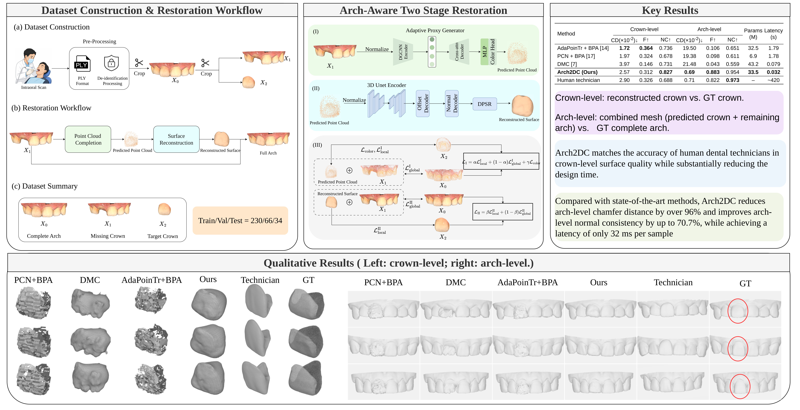

<div align="center">

# Arch2DC

**Arch-Aware Two-Stage Dental Crown Restoration with Local-Global Dual Constraints**

[](https://huggingface.co/XavierJiezou/arch2dc-models)

</div>

---

## Overview

**Arch2DC** is a two-stage arch-aware framework for automatic missing dental crown restoration. Given a defective intraoral arch scan, it:

1. **Stage I** — predicts the missing crown point cloud and its RGB color with an AdaPoinTr-based completion network under local–global dual-constraint supervision (α = 0.8).
2. **Stage II** — reconstructs a continuous triangular mesh from the predicted point cloud with an SAP-based network under local–global dual-constraint supervision (β = 0.9, δ = 0.05).



### Notation and data flow

| Symbol | File | Meaning | Used at inference? |
|---|---|---|---|
| X0 | `{id}_0.ply` | complete arch (ground truth) | **no** — training supervision and evaluation target only |
| X1 | `{id}_1.ply` | defective arch (crown 11 removed) | **yes** — the only input |
| X2 | `{id}_3.ply` | ground-truth crown | **no** — training supervision and evaluation target only |

```
X1 ──norm(X1)──► Stage I ──► predicted crown points + RGB ──norm(X1 ∪ pred)──► Stage II ──► crown mesh ──► merged with X1
```

### Coordinate normalization

Both stages normalize coordinates only with information available at inference:

- **Stage I**: centroid and maximum radius of the defective arch X1.
- **Stage II**: axis-aligned bounding box of X1 ∪ the Stage I predicted crown, mapped to the SAP unit cube `[0, 1]^3`.

During training, the ground-truth crown X2 and the complete arch X0 are mapped with the same parameters and serve as supervision only. X0 additionally defines the evaluation frame (see [Evaluation](#evaluation)).

## Installation

Tested with Python 3.10, PyTorch 2.7.1 + CUDA 11.8 on a single RTX 3090.

```bash
conda create -n arch2dc python=3.10 -y
conda activate arch2dc

# PyTorch / torch-scatter / pytorch3d
pip install torch==2.7.1 torchvision==0.22.1 --index-url https://download.pytorch.org/whl/cu118
pip install torch-scatter -f https://data.pyg.org/whl/torch-2.7.0+cu118.html
pip install --no-build-isolation "git+https://github.com/facebookresearch/pytorch3d.git@stable"

# Python packages
pip install -r requirements.txt

# CUDA extensions
pip install --no-build-isolation "git+https://github.com/erikwijmans/Pointnet2_PyTorch.git#egg=pointnet2_ops&subdirectory=pointnet2_ops_lib"
(cd extensions/chamfer_distance && python setup.py install)
(cd extensions/earth_movers_distance && python setup.py install)
```

The exact environment export used in our experiments is available as [`environment.yml`](https://huggingface.co/XavierJiezou/arch2dc-models/blob/main/environment.yml) for reference. It contains locally built packages (`chamfer-3d`, `emd-cuda`, `pointnet2-ops`), so use the steps above rather than `conda env create` with it.

## Data

The clinical data cannot be publicly shared. To train on your own data, place one sample per id under `data/tooth2/`:

```
data/tooth2/
├── 1_0.ply    # X0: complete arch (point cloud with RGB)
├── 1_1.ply    # X1: defective arch
├── 1_3.ply    # X2: ground-truth crown
└── ...        # *_2.ply / *_4.ply (half-crown variants) are not used
```

All three files of a sample must share the same world coordinate frame (X1 and X2 are subsets of X0's surface). Ids are sorted numerically and split 70% / 20% / 10% into train / val / test (230 / 66 / 34 for our 330 cases).

## Pretrained Models

```bash
huggingface-cli download XavierJiezou/arch2dc-models --local-dir ./checkpoints
```

| File | Description |
|------|-------------|
| `arch2dc/stage1_best_l1_cd.pth` | Arch2DC Stage I (AdaPoinTr + dual constraint, α = 0.8) |
| `arch2dc/stage2_model_best.pt` | Arch2DC Stage II (SAP dual constraint, β = 0.9, δ = 0.05) |
| `stage1_pcn/best_l1_cd.pth` | PCN baseline Stage I |
| `stage1_adapointr_bpa/best_l1_cd.pth` | AdaPoinTr+BPA baseline Stage I |
| `dmc/best_val.pth` | DMC baseline |

## Training

Use one GPU (e.g. `export CUDA_VISIBLE_DEVICES=0`). With several visible GPUs, Stage II switches to `DataParallel`.

**Stage I — point cloud + color completion** (~25 min on one RTX 3090):

```bash
python train.py --exp_name arch2dc_stage1 --data_root data/tooth2 \
    --use_color --local_weight 0.8 --full_weight 0.2 --color_weight 0.2 \
    --epochs 200 --batch_size 8 --lr 1e-4
# -> logs/adapointr/arch2dc_stage1/checkpoints/best_l1_cd.pth (lowest validation loss)
```

**Export Stage I predictions** for all splits (inputs of Stage II):

```bash
python export_stage1.py --ckpt logs/adapointr/arch2dc_stage1/checkpoints/best_l1_cd.pth \
    --data_dir data/tooth2 --out_dir results/stage1_pred
# -> results/stage1_pred/{train,val,test}/predtooth/*.ply
# -> results/stage1_pred/lists/{train,val,test}.lst   (columns: predtooth  X0  X2, absolute paths)
```

**Stage II — surface reconstruction** (~1 h on one RTX 3090). SAP scripts are run from `shape_as_points/`:

```bash
cd shape_as_points
python train_tooth_dual.py configs/learning_based/tooth_dual/arch2dc.yaml \
    --train_list ../results/stage1_pred/lists/train.lst \
    --val_list   ../results/stage1_pred/lists/val.lst
# -> shape_as_points/out/arch2dc_stage2/model_best.pt (validated every 5 epochs)
```

## Evaluation

All metrics are computed on the **test** split. Model inputs are normalized as described above; for scoring, predictions and ground truth are expressed in the frame of the complete arch X0 (Stage I: X0 centroid / max radius; Stage II: X0 bounding box with its longest edge scaled to [-1, 1]). This frame is used for evaluation only.

```bash
# Stage I: crown / arch L1-CD, L2-CD, F-score@0.01, Hausdorff, color L1
python eval.py --exp_name arch2dc_stage1 --data_root data/tooth2 --use_color

# Stage II + merge with X1: crown-level and arch-level CD / F-score / NC / HD
cd shape_as_points
python eval_tooth_dual.py configs/learning_based/tooth_dual/arch2dc.yaml \
    --checkpoint out/arch2dc_stage2/model_best.pt \
    --test_list ../results/stage1_pred/lists/test.lst \
    --output_dir out/arch2dc_stage2/eval_test
# -> eval_test/result.csv (per-sample rows + MEAN), tooth_mesh/, combined/
```

In `result.csv`, `chamfer-L1 / f-score / normals / hd` are crown-level and `combined_*` are arch-level (crown merged with X1 vs. X0). The table below reports CD × 10².

## Inference

End-to-end restoration of one defective arch scan. Only X1 is needed:

```bash
# 1) Stage I: missing crown point cloud (+RGB), in the input's world coordinates
python inference_stage1.py --ckpt checkpoints/arch2dc/stage1_best_l1_cd.pth \
    --input path/to/defective_arch.ply --output outputs/crown_pred.ply

# 2) Stage II: crown mesh, optionally merged with the defective arch
python inference_stage2.py --ckpt checkpoints/arch2dc/stage2_model_best.pt \
    --pred outputs/crown_pred.ply --arch path/to/defective_arch.ply \
    --output outputs/crown_mesh.ply --combined outputs/arch_restored.ply
```

Stage I samples N = 4096 input points and predicts M = 2048 crown points; Stage II normalizes the predicted crown with the bounding box of X1 ∪ the predicted crown and reconstructs the mesh with differentiable Poisson surface reconstruction on a 128³ grid.

## Main Results

Crown-level: reconstructed crown vs. GT crown. Arch-level: combined mesh (predicted crown + defective arch) vs. GT complete arch. CD values are scaled by 10⁻². Latency is per-sample inference time on a single NVIDIA RTX 3090; † denotes Stage II using the CPU-based Ball-Pivoting Algorithm (BPA). **Bold** = best, <u>underline</u> = second-best.

| Method | Crown CD↓ | Crown F-score↑ | Crown NC↑ | Arch CD↓ | Arch F-score↑ | Arch NC↑ | Params (M) | Latency (s) |
|--------|:---------:|:--------------:|:---------:|:--------:|:-------------:|:--------:|:----------:|:-----------:|
| AdaPoinTr + BPA | **1.72** | **0.364** | <u>0.736</u> | 19.50 | 0.106 | 0.651 | <u>32.5</u> | 1.79† |
| PCN + BPA | <u>1.97</u> | 0.324 | 0.678 | 19.38 | 0.098 | 0.611 | **6.9** | 1.78† |
| DMC | 3.97 | 0.146 | 0.731 | 21.48 | 0.043 | 0.559 | 43.2 | <u>0.079</u> |
| **Arch2DC (Ours)** | 2.57 | 0.312 | **0.827** | **0.69** | **0.883** | <u>0.954</u> | 33.5 | **0.032** |
| Human Technician | 2.90 | <u>0.326</u> | 0.688 | <u>0.71</u> | <u>0.822</u> | **0.973** | — | ~420 |

## Repository Structure

```
train.py / eval.py              Stage I training / evaluation (dataset/tooth_nomask.py, models/adapointr_nomask.py)
export_stage1.py                Stage I predictions for train/val/test -> Stage II lists
inference_stage1.py / inference_stage2.py   single-sample inference
shape_as_points/
  train_tooth_dual.py           Stage II training (src/training_tooth_dual.py: dual-constraint loss)
  eval_tooth_dual.py            Stage II reconstruction, merging with X1, evaluation
  src/data/tooth_dual.py        Stage II dataset, X1 ∪ prediction bounding-box normalization, global neighborhood selection (δ)
  src/mesh_evaluator.py         CD / F-score / NC metrics
  configs/learning_based/tooth_dual/arch2dc.yaml   paper configuration
```

## Acknowledgements

- [AdaPoinTr](https://github.com/yuxumin/PoinTr)
- [Shape As Points (SAP)](https://github.com/autonomousvision/shape_as_points)
- [NoKSR](https://github.com/theialab/noksr) (mesh evaluation metrics, Apache-2.0)
- [DMC](https://github.com/lmb-freiburg/DMC)
